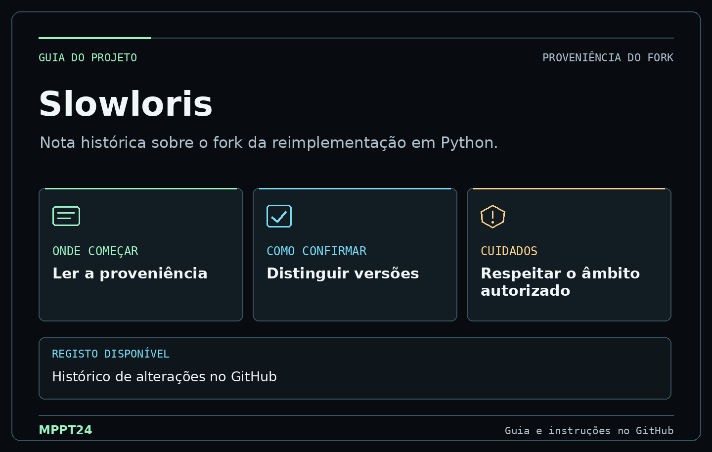

# Guia de Slowloris

**Estado:** Proveniência do fork.

Nota histórica sobre o fork da reimplementação em Python.

## Onde começar

Consulta [PROVENIENCIA.md](PROVENIENCIA.md) para ver a origem registada.

## Como confirmar

A relação de fork no GitHub identifica o repositório de referência.

## Como ler os registos

O histórico de commits documenta mudanças. Este guia não inclui registos de execução da ferramenta.

Para localizar uma alteração, usa a data e a mensagem do commit no histórico Git.

## Cuidados

Qualquer teste de carga exige autorização explícita e um ambiente isolado. Este guia trata apenas da proveniência.
